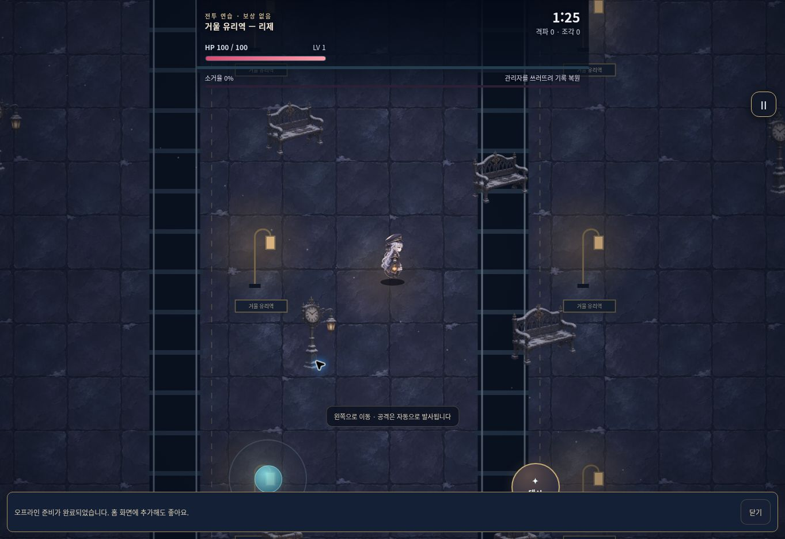

# v0.10.0 묶음 검증 기록

날짜: 2026-11-17. 게임 구현 커밋: 8b6e766557733f6181eea0076122aa0217a72e93.

## 구현과 자동 검증

- GitHub CI: 자동 테스트 100개 통과, 배포 성공.
- 보스 보상 3종 선택·사건과 출발 게이트·재접속·구버전 호환·저장 실패 중복 방지 확인.
- 신규 환경 소품 4종의 결정적 월드 배치·컬링·낮은 품질 밀도·공격 예고보다 뒤에 그리기 확인.
- 실제 리제/적/바닥/새 환경 WebP를 불러 세 역을 390×844 Canvas로 렌더링해 시각 검수.
- 장거리 주 칼날 명중: 투사체 1~5개 각각 검사. 수정 전 2/4개에서 표적을 모두 빗나갔으나 수정 후 주 칼날 적중.
- 이전 ±5000 경계를 넘는 이동과 30초 직선 이동 검증.
- 기존 자동 일시정지·앱 전환·터치·PWA 회귀 테스트 포함.

## 배포된 페이지의 직접 확인

원격 Chrome에서 https://jiseong0310ab-del.github.io/terminus-girl/ 를 열어 v0.10.0-rc1 표시, 90초 연습 시작, 리제와 환경 소품 표시, 이동 입력, 오프라인 준비 안내를 확인했다. 게임 코드에서 발생한 오류는 관찰하지 않았고, 브라우저 확장 자체의 metadata 전송 오류는 별도로 나타났다.

이 확인은 실제 아이폰이 아니며, 브라우저가 관측 사이에 프레임을 제한하므로 FPS/발열/실시간 타이머 정확성의 증거로 쓰지 않는다. 보스 보상 끝까지 직접 플레이한 검증도 아니다.

## 환경 제약과 남은 작업

로컬 Playwright는 브라우저 프로세스의 socket 생성이 실행 환경에서 거부되어 실행되지 않았다. 대신 실제 Canvas 렌더와 원격 페이지 확인을 수행했다. 로컬 모바일 브라우저의 전체 보상/재접속 흐름이 통과했다고 주장하지 않는다.

실제 아이폰 Safari와 홈 화면에서 첫 장 완주·30분 발열/프레임·오디오·긴 터치·자동 정지 재발·보상 재개·새 에셋 오프라인/업데이트를 확인해야 한다. 다음 개발은 정예/보스 변화와 반복 플레이 동기를 우선한다.
