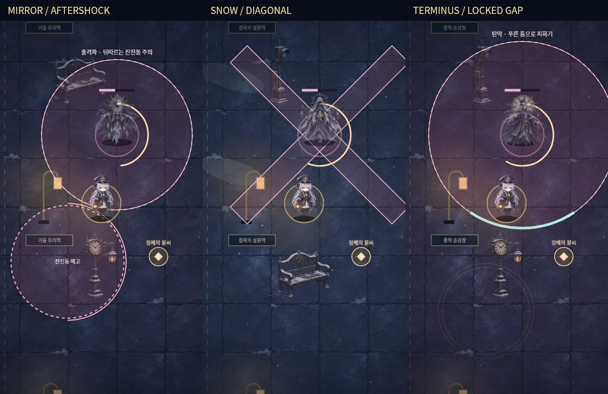

# v0.11 전투 확장 검증

2026-11-17 · v0.11.0-rc1

- 새 엔진 회귀 10개: HP 전환과 예고 고정·거울 잔진동 지연/일회 피해·설원 기본/대각선 판정·종착 1/2단계 탄막 안전구간·정예 불씨 중복/만료/회복/과충전 보존·역 이동 초기화.
- 새 렌더/UI 회귀 4개: 단계 표시·현재 예고 형태와 안전구간·고정 잔진동 위치·불씨 컬링/남은 시간/웨이브 안내 우선.
- 기존 저장/재개·정산·PWA·입력·이동·다중 칼날·시너지 테스트를 포함해 총 114개 통과.
- 실제 리제/보스/바닥/소품 이미지를 불러 세 후반 패턴을 390×720 Canvas로 렌더링해 확인.

이 이미지는 실제 렌더러를 사용한 고정된 테스트 장면이며, 완주한 플레이 녹화나 실제 아이폰 스크린샷이 아니다. 상태를 강제로 구성해 예고 형태를 검수했다.

실제 플레이에서 확인할 것: 50% HP 이후 난이도, 현재 예고를 유지한 전환의 이해도, 지연 충격파 회피 여유, 정예 불씨 회수 위험/보상, 긴 터치 자동 정지 재발, 30분 발열/프레임·오디오·오프라인/업데이트.
