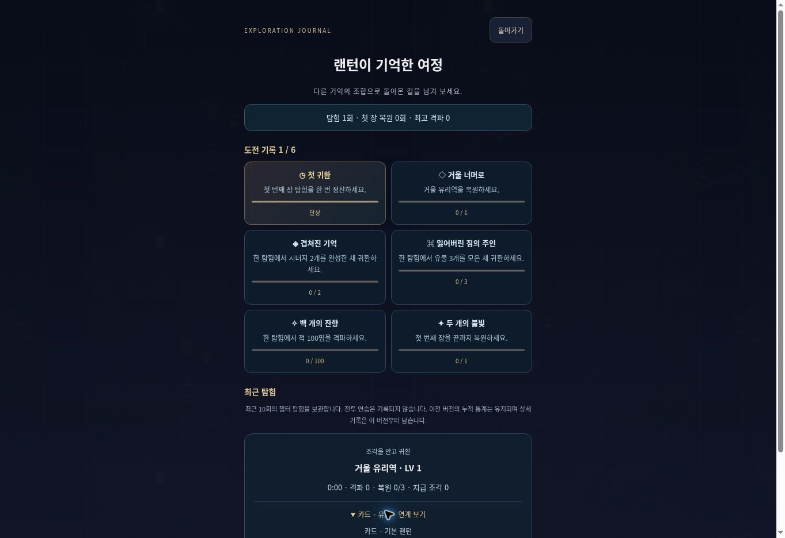

# v0.12 탐험 기록·도전 검증

2026-11-17 · v0.12.0-rc2

- 새 저장 테스트 10개: 정산/최종 빌드·중복·연습 제외·10회 기록/달성 유지·구버전·백업/재접속·저장 실패·탭 충돌·잘못된 데이터·체크포인트 귀환.
- 새 UI 테스트 3개: 열차에서 진입/빈 상태, 실제 결과의 새 달성/카드·유물·연계 기록과 화면 복귀, 연습 결과 제외.
- 기존 전투·저장·입력·PWA 검증 포함 자동 테스트 129개 통과.
- 재화 보상 정산 규칙은 유지한다. 오래된 누적 통계는 보존하되 과거의 상세 빌드/결과를 만들어 채우지 않는다.

## 실제 화면 확인

원격 Chrome의 배포된 v0.12.0-rc1 페이지에서 실제 UI로 확인했다. 빈 기록/6개 목표 확인 → 챕터 시작 → 일시정지 → 귀환 확인/정산 → 첫 귀환 달성/탐험 1회 기록 확인 → 새로고침 → 탐험 1회·도전 1/6 보존 → 상세 열기로 기본 카드/유물/연계 확인. 직접 브라우저 상태를 변조하지 않았다. 이후 rc2에서 저장 실패 결과 안내를 보강하고 자동 회귀 검증을 추가했다.

이 흐름은 0초에 가까운 즉시 귀환 테스트이며 장시간 플레이나 아이폰 완주 검증이 아니다. 실시간 타이머 성능도 이 원격 브라우저로 판단하지 않는다.

## 호환과 실기 한계

기존 저장 형식에 항목을 추가했다. 이전 버전 코드로 롤백하면 새 기록 필드가 보존되지 않을 수 있으므로 롤백 전 새 버전에서 백업한다. 실제 아이폰의 스크롤·접근성·긴 플레이·발열·오디오·자동 정지 재발 QA는 미완료다.
